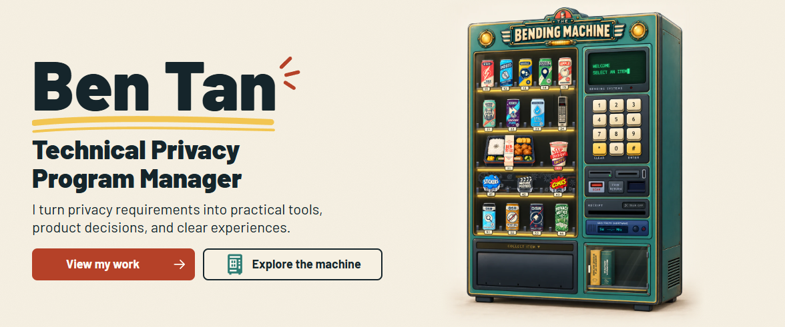

  &nbsp; 
  &nbsp; 
  <a href="https://ko-fi.com/itsbent"><picture><source media="(prefers-reduced-motion: reduce)" srcset="images/buttons/kofi-static.svg"></picture></a>&nbsp; 

## Privacy tools

- [Test Data Generator](https://ben-tan.com/tools/test-data-generator/) — Generate realistic US sample contacts for demos, forms, and QA.
- [PII De-identifier](https://ben-tan.com/tools/pii-deidentifier/) — Find likely personal information in files and review how it is treated.
- [Privacy Decision Guides](https://ben-tan.com/tools/privacy-decisions/) — Work through privacy questions with reasoning and source links.

## Guides and study

- [Anatomy of a Privacy Notice](https://ben-tan.com/guides/privacy-notice/) — Compare detailed and plain-language examples with drafting explanations.
- [CIPT Studio](https://ben-tan.com/certification/cipt-studio/) — Study privacy technology through explanations, retrieval practice, and concept labs. Independent preparation, not an IAPP product.

## Art and play

[Explore the Bending Machine](https://ben-tan.com/machine/) · [Comic Panels](https://ben-tan.com/guides/comic-panels/) · [Movie Posters](https://ben-tan.com/guides/movie-posters/) · [Stickers](https://ben-tan.com/stickers/)

[View the full landing-page image](images/landing.png)
